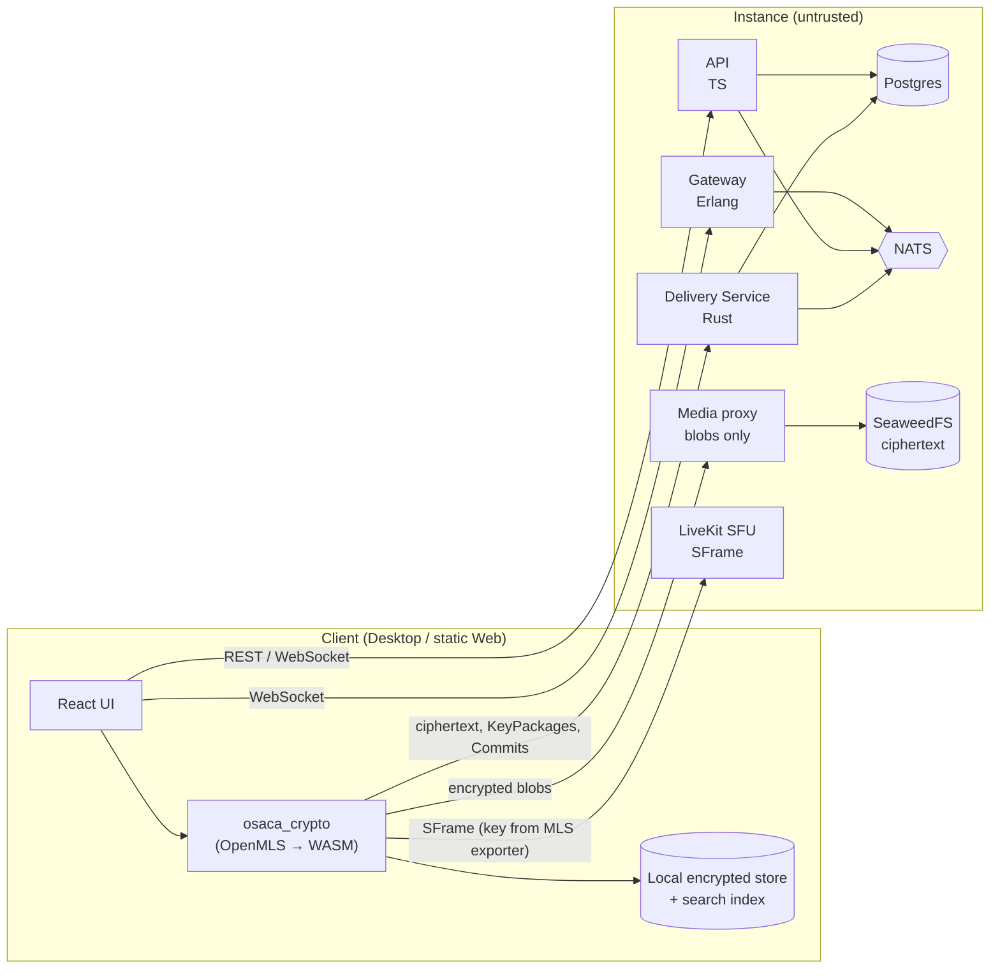

# OSACA Technical Survey

**OSACA (Open Source Anonymous Community App)** is a hard fork of [Fluxer](https://github.com/fluxerapp/fluxer), a free, open-source, self-hosted chat and VoIP app in the style of Discord. OSACA keeps the community product and makes **user anonymity the primary goal**: the person running the server must not be able to read content or identify users.

This note covers the Fluxer baseline, the gap analysis, every decision taken, and the delivery plan. Terms are defined in [[GLOSSARY]]. Decisions are in the [[#Decision log]] and the ADRs in `docs/adr/`.

> [!abstract] Verdict
> **Feasible, but large.** Phase F0 (strip the surveillance) is mostly deletion and is realistic for a part-time team. Phases F1–F2 (E2EE with MLS) are a deep rewrite of the message path, the data model and the client. The hardest single problem is **group membership that an untrusted server cannot forge** ([[0007-signed-membership-and-roles]]). Everything relies on audited libraries. No crypto is written by hand.

---

## 1. The problem

Today a Fluxer Operator sees, by design:

- **All message content** in plaintext, in the database and in the search index.
- **All attachments**, unencrypted in S3.
- **Identity metadata**: IP addresses, user agents, country, city and coordinates (MaxMind GeoIP), session history, email changes, DM history, Community visits.
- **Admin superpowers**: reading any channel or DM (including channels hidden by permissions), seeing IPs with reverse DNS and location, changing a user's email, disabling MFA, generating user data archives.

> [!danger] Result
> Anonymity towards the Operator is effectively zero, and a seized disk exposes everything.

## 2. Fluxer baseline

Surveyed from the code on 2026-11-03. File paths below are as inherited, before the rename; replace `fluxer_` with `osaca_` to find them today ([[0001-hard-fork-as-osaca]]).

### 2.1 Architecture

| Component | Language | ~LOC | Role |
| --- | --- | --- | --- |
| `fluxer_app` | TS/React/MobX + Rust/WASM | 638k | Web client (Rspack) |
| `fluxer_api` | TS (Hono) | 375k | REST API + worker (cron, jobs) |
| `fluxer_gateway` | Erlang/OTP | 90k | WebSocket gateway, presence, voice grants, push fan-out |
| `fluxer_desktop` | Electron 44 + Rust | 82k | Desktop client |
| `fluxer_admin` | Rust (axum, maud) | 53k | Admin panel |
| `fluxer_rexctl` | Go | 50k | Self-host installer / operator CLI |
| `fluxer_media_proxy` | Rust + libvips | 26k | Uploads, transforms, external media proxy, NSFW |
| `packages/voice_engine_v2` | TS | 15k | Client voice state machine |
| `fluxer_unfurl` | Rust | 9k | Server-side link previews, oEmbed, ActivityPub fetch |
| `fluxer_push` | Rust | 6.5k | FCM / APNs / Web Push / UnifiedPush + relay |
| `fluxer_messages`, `fluxer_users`, `fluxer_gifs`, `fluxer_snowflakes` | Rust | ~7k | Small NATS RPC services on `fluxer_svc` |

- **Transport.** Clients use HTTPS REST plus the gateway WebSocket. Services talk to each other over NATS/JetStream. Caddy is the edge.
- **Data.**
  - Postgres (default) is a generic KV table driven by a Cassandra-style DSL; Cassandra/Scylla is an alternative backend. About 177 logical tables in `fluxer_api/src/api/Tables.ts`.
  - Valkey, NATS, Meilisearch/Elasticsearch, SeaweedFS (S3) and LiveKit.
- **Federation.** None. Instances are isolated. ActivityPub exists only as an "Application" actor used for signed unfurl fetches.
- **Mobile.** Not in this repository. The Android and iOS clients live elsewhere.
- **License.** AGPL-3.0-or-later. Artwork CC BY-SA 4.0. The Fluxer name and marks are **not** licensed for reuse.

### 2.2 Where the server reads content

| Path | Evidence |
| --- | --- |
| Plaintext message storage | `MessageRow.content` in `fluxer_api/src/api/database/types/MessageTypes.ts` |
| Full-text search | `fluxer_api/src/api/search/message/MessageSearchSerializer.ts` |
| Server-side unfurl | `fluxer_api/src/worker/tasks/ExtractEmbeds.ts` → `fluxer_unfurl` |
| Banned-phrase moderation | `ContentModerationService.scanText` |
| ClamAV, NSFW scoring, banned hashes | `fluxer_api/pkgs/virus_scan`, `fluxer_media_proxy/src/nsfw.rs` |
| Mention extraction | `fluxer_messages` + `packages/markdown_parser` |
| Push previews (100 bytes) | `fluxer_gateway/src/push/push_notification_format.erl` |
| Admin message lookup | `fluxer_docs/.../admin-api/messages.mdx` (`message:lookup`) |

### 2.3 Identity and metadata stored

- **`UserRow`** stores:
  - account credentials: email, `password_hash` (argon2), a plaintext `totp_secret`;
  - profile: `date_of_birth`, timezone, locale;
  - activity: `last_active_ip`;
  - billing: Stripe IDs.
- **Sessions** store `client_ip`, user agent, OS and country, with **no TTL**.
- **Tables:**
  - IP tables: `authorized_ips_v2`, `users_by_last_active_ip`, `banned_ips`, `attachment_upload_traces` (30 days).
  - Activity tables: `guild_visits`, `user_dm_history`, `user_contact_change_logs` (no TTL).
- **Push** relays through `push.fluxer.com` by default, then Google or Apple.
- **Retention.** `admin_audit_logs` has no TTL; moderation evidence is kept for 365 days.

### 2.4 What already helps

- [x] **Username-only signup** with a recovery kit, and no phone field.
- [x] **ALTCHA proof-of-work captcha**, with no third party.
- [x] **No third-party analytics.**
- [x] **Single-instance model** (no federation to unwind).
- [x] **LiveKit SFrame frame-encryption plumbing** (`VoiceE2EEKeyProvider.ts`). The key is server-generated today, and the docs admit "this isn't end-to-end encryption".
- [x] **Rust → WASM toolchain** already in the client (`libfluxcore`), which is the natural home for OpenMLS.

## 3. Gap analysis

Difficulty: 🟢 low · 🟡 medium · 🔴 high · ⚫ research-grade.

| Area | Fluxer today | OSACA target | Difficulty | Phase | ADR |
| --- | --- | --- | --- | --- | --- |
| Branding | Fluxer everywhere | One mechanical rename `fluxer_*` → `osaca_*` | 🟢 | F0 | [[0001-hard-fork-as-osaca]] |
| Billing, GIFs, GeoIP, push relay | Present | Removed | 🟢 | F0 | [[0009-metadata-minimisation-and-anonymous-accounts]] |
| Email, OIDC, date of birth | Optional/required | Removed; username-only | 🟡 | F0 | [[0009-metadata-minimisation-and-anonymous-accounts]] |
| IP / UA / country storage | Many tables, no TTL | Never stored; short TTLs elsewhere | 🟡 | F0 | [[0009-metadata-minimisation-and-anonymous-accounts]] |
| Admin panel | Reads everything | Operational only | 🟡 | F0 | [[0010-operational-admin-panel]] |
| Datastores | Postgres or Cassandra, Meili or ES | Postgres only | 🟡 | F0 | [[0015-postgres-only-and-fresh-install]] |
| DM / group DM content | Plaintext | MLS E2EE | 🔴 | F1 | [[0004-mls-with-openmls]] |
| Key verification | None | Safety Numbers (TOFU) | 🟡 | F1 | [[0005-key-verification]] |
| Delivery Service | n/a | New Rust service on `fluxer_svc` | 🔴 | F1 | [[0004-mls-with-openmls]] |
| Message data model | Plaintext rows | Ciphertext rows (group, epoch, blob) | 🔴 | F1 | [[0015-postgres-only-and-fresh-install]] |
| Attachments | Plain S3 | Client-encrypted blobs | 🟡 | F1 | [[0008-no-server-side-content-processing]] |
| Search | Server index | Local encrypted index | 🟡 | F1 | [[0008-no-server-side-content-processing]] |
| Link previews | Server unfurl | Sender-side, off by default | 🟢 | F1 | [[0008-no-server-side-content-processing]] |
| Push | 100-byte preview | Wake-up Push | 🟢 | F1 | [[0008-no-server-side-content-processing]] |
| Edits, reactions, mentions, deletes | Server-side | Encrypted MLS messages, client-side mentions | 🔴 | F1 | [[0008-no-server-side-content-processing]] |
| Community E2EE | Plaintext | Community group + Private Channel groups | 🔴 | F2 | [[0006-mls-group-topology]] |
| Membership and roles | Server-enforced | Signed Governance Events, Ghost Member detection | ⚫ | F2 | [[0007-signed-membership-and-roles]] |
| Voice / video | Server-issued SFrame key | Key from MLS exporter, rotated on join/leave | 🟡 | F2 | [[0014-voice-e2ee-from-mls]] |
| Multi-device | Sessions | Device leaves, QR linking, device-to-device history | 🔴 | F3 | [[0013-multi-device]] |
| Key backup | n/a | Inside the Recovery Kit | 🟡 | F3 | [[0013-multi-device]] |
| History for new members | Full | None (v1), shared history later | 🔴 | F4 | [[0012-encrypted-history-on-server]] |
| Profiles | Plaintext | Minimal (v1), encrypted later | 🟡 | F4 | [[0009-metadata-minimisation-and-anonymous-accounts]] |
| Key Transparency, Message Franking | n/a | Later | ⚫ | F4 | [[0016-phased-delivery-and-security-validation]] |
| Web client trust | Served by the Instance | Signed static build, off-Instance | 🟡 | F1/F4 | [[0011-client-platforms]] |

## 4. Target architecture

> [!important] Invariant
> No component inside **Instance** ever receives a plaintext message, a plaintext attachment, or a private key. The security test suite in [[0016-phased-delivery-and-security-validation]] enforces this.

## 5. Delivery plan

Each phase ships something usable on its own ([[0016-phased-delivery-and-security-validation]]).

- [ ] **F0 – "Fluxer without surveillance".**
  - Rename everything to OSACA.
  - Remove billing, GIFs, GeoIP, the push relay, email/OIDC and date of birth.
  - Stop storing IP, user agent and country, and add TTLs.
  - Cut the admin panel down to operational tasks.
  - Run on Postgres only, with no search engines.
- [ ] **F1 – E2EE DMs and group DMs.**
  - `osaca_crypto` (OpenMLS/WASM) and the Delivery Service.
  - Encrypted attachments, local search and Wake-up Push.
  - Safety Numbers and sender-side link previews.
- [ ] **F2 – E2EE Communities.**
  - One MLS group per Community plus one per Private Channel.
  - Signed Governance Events and Ghost Member detection.
  - Voice E2EE.
- [ ] **F3 – Multi-device.** QR linking, device-to-device history and key backup in the Recovery Kit.
- [ ] **F4 – Later.**
  - Shared history and encrypted profiles.
  - Key Transparency and Message Franking.
  - Mobile, a static web build on IPFS, and an official `.onion` deployment.

### Rough effort (part-time, occasional helpers)

These are order-of-magnitude estimates, not commitments:

| Phase | Estimate | Main risk |
| --- | --- | --- |
| F0 | 2–4 months | Hidden coupling to the removed features across 177 tables |
| F1 | 6–10 months | Rewriting the message path end to end, client and server |
| F2 | 6–12 months | Governance design ([[0007-signed-membership-and-roles]]) |
| F3 | 3–5 months | State sync between Devices |
| F4 | Open-ended | Mostly research and new platforms |

## 6. Risks

> [!warning] Top risks
> 1. **Governance is the security boundary.** If membership or role changes can be forged, group E2EE is decorative against a malicious Operator. It must be specified and reviewed before F2 code.
> 2. **The web client.** Any web client served by the Instance can be swapped for a malicious one. Desktop is the reference client until a signed, off-Instance web build exists ([[0011-client-platforms]]).
> 3. **Operator legal exposure.** Operators cannot scan content. This has to be documented clearly for anyone hosting an Instance ([[0008-no-server-side-content-processing]]).
> 4. **Capacity.** About 1.3M LOC maintained part-time. Remove code before building on it.
> 5. **No audit yet.** Ship as "experimental, unaudited" until an external audit (NLnet / NGI Zero) happens.

## 7. Open questions

These branches were not covered in the design session and need their own decision before the phase that touches them:

- [ ] **Bots and webhooks (F2).** Webhooks post plaintext from outside, and a bot would have to be an MLS member with its own Device. Do we keep, redesign or drop them?
- [ ] **Threads and forums (F2).** Each thread is either a separate MLS group or shares the parent channel's group.
- [ ] **Member list and search in large Communities (F2).** What may the server know about who is in a Community?
- [ ] **Presence and typing indicators (F1).** These are metadata. Encrypt them, minimise them, or make them opt-in?
- [ ] **Rate limiting without IPs (F0).** The concrete token / proof-of-work design ([[0009-metadata-minimisation-and-anonymous-accounts]]).
- [ ] **Data export (F1).** Today the server builds a user's data archive. Under E2EE the export has to be built by the client.
- [ ] **Artwork (F0).** Logos, wordmarks and tray icons were renamed to `osaca-*` but still show Fluxer's art, whose marks are not licensed to OSACA. Replace them before any public release.
- [ ] **Placeholder domains (F0).** Fluxer domains became `*.osaca.example`. Every hard-coded default has to become operator configuration or be removed.

## Decision log

Decided in the design session on 2026-11-03.

| # | Decision | ADR |
| --- | --- | --- |
| Q1 | Full protection against a curious Operator, a malicious or compromised Operator, and data seizure. Partial protection against network observers (Tor/proxy). None against a global adversary. | [[0002-threat-model]] |
| Q2 | Content (E2EE) and identity anonymity are mandatory from v1; metadata privacy improves progressively | [[0002-threat-model]] |
| Q3 | No federation | [[0003-no-federation]] |
| Q4 | Hard fork, AGPL-3.0-or-later, credit Fluxer | [[0001-hard-fork-as-osaca]] |
| Q5 | Part-time with occasional helpers: audited libraries only, delete before building | [[0016-phased-delivery-and-security-validation]] |
| Q6 | Desktop first; web only as a signed static build hosted off the Instance; mobile later | [[0011-client-platforms]] |
| Q7 | Safety Numbers (TOFU) in v1, Key Transparency later | [[0005-key-verification]] |
| Q8 | Admin panel is operational only | [[0010-operational-admin-panel]] |
| Q9 | Remove billing, Klipy GIFs, the Fluxer push relay and MaxMind GeoIP | [[0009-metadata-minimisation-and-anonymous-accounts]] |
| Q10 | MLS via OpenMLS for DMs and groups | [[0004-mls-with-openmls]] |
| Q11 | Client-side search; the server keeps only the Community Directory | [[0008-no-server-side-content-processing]] |
| Q12 | Sender-side link previews, off by default | [[0008-no-server-side-content-processing]] |
| Q13 | Moderation by Community Moderators plus reports; no server-side scanning | [[0008-no-server-side-content-processing]] |
| Q14 | Wake-up Push only | [[0008-no-server-side-content-processing]] |
| Q15 | Client-encrypted attachments; the media proxy handles blobs only | [[0008-no-server-side-content-processing]] |
| Q16 | No IP/UA/country stored, short TTLs, `.onion` and SOCKS support | [[0009-metadata-minimisation-and-anonymous-accounts]] |
| Q17 | Username-only accounts, no date of birth, keys backed up in the Recovery Kit | [[0009-metadata-minimisation-and-anonymous-accounts]] |
| Q18 | One MLS group per Community plus one per Private Channel | [[0006-mls-group-topology]] |
| Q19 | Signed membership and roles, Ghost Member detection | [[0007-signed-membership-and-roles]] |
| Q20 | No history for new members in v1; per-channel shared history later | [[0012-encrypted-history-on-server]] |
| Q21 | Each Device is a separate leaf, linked by QR, max 5 per Account | [[0013-multi-device]] |
| Q22 | The server stores ciphertext history; disappearing messages optional | [[0012-encrypted-history-on-server]] |
| Q23 | Edits, reactions and deletes are encrypted; mentions are computed on the client | [[0008-no-server-side-content-processing]] |
| Q24 | Voice SFrame key derived from the MLS exporter | [[0014-voice-e2ee-from-mls]] |
| Q25 | Minimal plaintext profiles in v1, encrypted profiles later | [[0009-metadata-minimisation-and-anonymous-accounts]] |
| Q26 | Keep the stack; add the `osaca_crypto` crate (WASM) and a Rust Delivery Service | [[0004-mls-with-openmls]] |
| Q27 | New ciphertext tables; fresh install only | [[0015-postgres-only-and-fresh-install]] |
| Q28 | Postgres only; no Cassandra, Meilisearch or Elasticsearch | [[0015-postgres-only-and-fresh-install]] |
| Q29 | One early mechanical rename `fluxer_*` → `osaca_*` | [[0001-hard-fork-as-osaca]] |
| Q30 | Phases F0 to F4 | [[0016-phased-delivery-and-security-validation]] |
| Q31 | "Experimental, unaudited" label, public threat model, security property tests, NLnet funding | [[0016-phased-delivery-and-security-validation]] |
| Q32 | Code and docs in English; README also in Portuguese | [[0001-hard-fork-as-osaca]] |
| Q33 | This survey, the ADRs, [[GLOSSARY]] and the [[fluxer-docs-rewrite-plan]] | — |
